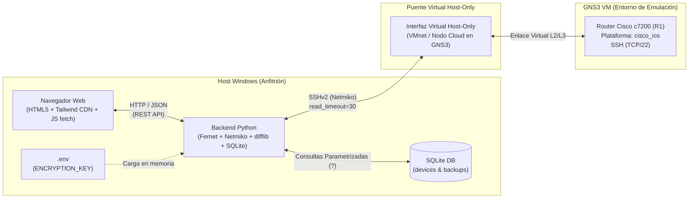
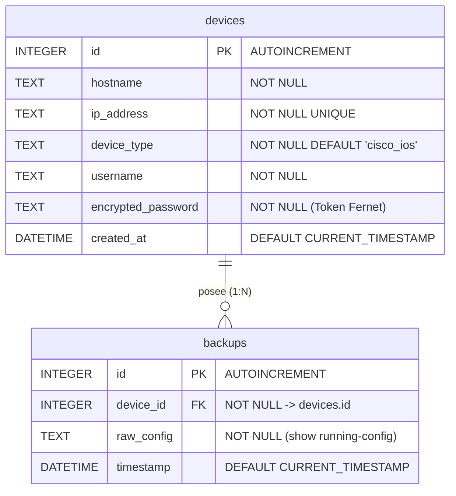
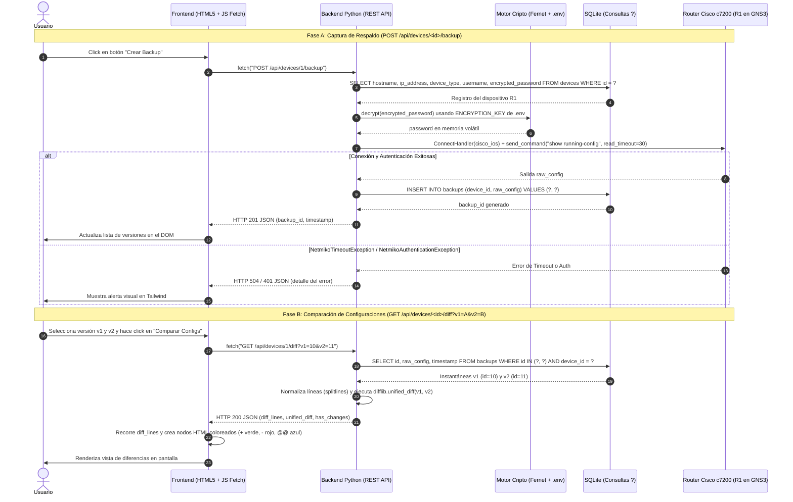

# Documento de Arquitectura del Sistema (`ARCHITECTURE.md`)

**Proyecto:** Network Config Manager  
**Rol Rector:** Lead System Architect  
**Versión:** 1.0.0

Este documento describe la arquitectura física y lógica de **Network Config Manager**, incluyendo la topología de interconexión con el entorno virtualizado GNS3, el esquema relacional en SQLite, los contratos de la API REST y el flujo de ejecución de extremo a extremo.

---

## 1. Topología de Red e Infraestructura

El sistema opera en un entorno híbrido local donde la aplicación de gestión reside en el sistema operativo anfitrión (**Host Windows**) y se comunica a través de un canal de red virtual aislado con el plano de gestión de los dispositivos emulados en **GNS3 VM**.

### Diagrama de Topología



### Especificación de Componentes de Red

1. **Host Windows (Plano de Gestión y Aplicación):**
   * Ejecuta el servidor backend en Python y aloja la base de datos SQLite junto con el archivo `.env`.
   * Posee una interfaz de red virtual (*Host-Only Adapter*, ej. `VMware Network Adapter VMnet1` o bucle invertido vinculado a GNS3) con una dirección IP dentro del segmento de gestión.
2. **Interfaz Virtual Host-Only (VMnet / Cloud en GNS3):**
   * Actúa como puente de Capa 2 entre el sistema operativo anfitrión Windows y la topología interna de GNS3.
   * En el lienzo de GNS3 se representa mediante un nodo **Cloud** vinculado a la interfaz `VMnet` correspondiente.
3. **Router Cisco c7200 (`R1`) en GNS3 VM:**
   * Imagen Cisco IOS serie 7200 ejecutándose sobre Dynamips dentro de la GNS3 VM.
   * Interfaz de gestión (ej. `FastEthernet0/0` o `GigabitEthernet0/0`) conectada al nodo Cloud, configurada con IP alcanzable desde el Host Windows, dominio IP definido, llaves RSA generadas (`crypto key generate rsa`), usuario local privilegio 15 y líneas `vty 0 4` habilitadas exclusivamente para `transport input ssh` y `login local`.

---

## 2. Modelo de Datos (SQLite)

La persistencia se implementa en SQLite puro aplicando integridad referencial y separación entre las entidades de inventario (`devices`) y las instantáneas de configuración (`backups`).

### Diagrama Entidad-Relación



### Definición DDL (SQL)

```sql
PRAGMA foreign_keys = ON;

CREATE TABLE IF NOT EXISTS devices (
    id INTEGER PRIMARY KEY AUTOINCREMENT,
    hostname TEXT NOT NULL,
    ip_address TEXT NOT NULL UNIQUE,
    device_type TEXT NOT NULL DEFAULT 'cisco_ios',
    username TEXT NOT NULL,
    encrypted_password TEXT NOT NULL,
    created_at DATETIME DEFAULT CURRENT_TIMESTAMP
);

CREATE TABLE IF NOT EXISTS backups (
    id INTEGER PRIMARY KEY AUTOINCREMENT,
    device_id INTEGER NOT NULL,
    raw_config TEXT NOT NULL,
    timestamp DATETIME DEFAULT CURRENT_TIMESTAMP,
    FOREIGN KEY (device_id) REFERENCES devices(id) ON DELETE CASCADE
);
```

### Diccionario de Datos

#### Tabla `devices`
| Columna | Tipo | Restricciones | Descripción |
| :--- | :--- | :--- | :--- |
| `id` | `INTEGER` | `PRIMARY KEY AUTOINCREMENT` | Identificador único del dispositivo. |
| `hostname` | `TEXT` | `NOT NULL` | Nombre lógico o administrativo del router (ej. `R1`). |
| `ip_address` | `TEXT` | `NOT NULL UNIQUE` | Dirección IPv4 de gestión alcanzable vía la red Host-Only. |
| `device_type` | `TEXT` | `NOT NULL DEFAULT 'cisco_ios'` | Driver de Netmiko asignado al equipo (`cisco_ios`). |
| `username` | `TEXT` | `NOT NULL` | Usuario SSH configurado en el dispositivo. |
| `encrypted_password` | `TEXT` | `NOT NULL` | Contraseña cifrada simétricamente con `Fernet` (codificada en Base64 URL-safe). |
| `created_at` | `DATETIME` | `DEFAULT CURRENT_TIMESTAMP` | Fecha y hora UTC de alta del dispositivo en el sistema. |

#### Tabla `backups`
| Columna | Tipo | Restricciones | Descripción |
| :--- | :--- | :--- | :--- |
| `id` | `INTEGER` | `PRIMARY KEY AUTOINCREMENT` | Identificador único de la versión de respaldo. |
| `device_id` | `INTEGER` | `NOT NULL, FOREIGN KEY` | Referencia al campo `id` de la tabla `devices`. |
| `raw_config` | `TEXT` | `NOT NULL` | Salida íntegra del comando `show running-config`. |
| `timestamp` | `DATETIME` | `DEFAULT CURRENT_TIMESTAMP` | Fecha y hora UTC exactas en que se capturó la configuración. |

---

## 3. Contratos de API REST

Todas las peticiones y respuestas utilizan el formato `application/json`. En ningún endpoint se expone jamás el campo `encrypted_password` ni la contraseña en claro.

---

### 3.1. Listar Dispositivos
* **Endpoint:** `GET /api/devices`
* **Descripción:** Retorna el inventario de dispositivos registrados junto con metadatos básicos (y opcionalmente el historial resumido de IDs/fechas de sus backups para poblar los selectores de versión en la UI).
* **Respuesta Exitosa (`200 OK`):**
```json
{
  "status": "success",
  "data": [
    {
      "id": 1,
      "hostname": "R1",
      "ip_address": "192.168.56.101",
      "device_type": "cisco_ios",
      "username": "admin",
      "created_at": "2026-11-09 18:30:00",
      "backups": [
        { "id": 10, "timestamp": "2026-11-09 18:35:12" },
        { "id": 11, "timestamp": "2026-11-09 18:45:00" }
      ]
    }
  ]
}
```

---

### 3.2. Registrar Nuevo Dispositivo
* **Endpoint:** `POST /api/devices`
* **Descripción:** Valida los datos de entrada, cifra la contraseña en texto plano utilizando `Fernet(ENCRYPTION_KEY).encrypt()` y almacena el dispositivo mediante una sentencia `INSERT` parametrizada.
* **Request Body (`application/json`):**
```json
{
  "hostname": "R1",
  "ip_address": "192.168.56.101",
  "device_type": "cisco_ios",
  "username": "admin",
  "password": "CiscoSecretPassword123!"
}
```
* **Respuesta Exitosa (`201 Created`):**
```json
{
  "status": "success",
  "message": "Dispositivo registrado correctamente.",
  "data": {
    "id": 1,
    "hostname": "R1",
    "ip_address": "192.168.56.101",
    "device_type": "cisco_ios",
    "username": "admin",
    "created_at": "2026-11-09 18:30:00"
  }
}
```
* **Respuestas de Error:**
  * `400 Bad Request`: Campos obligatorios faltantes o formato IP inválido.
  * `409 Conflict`: La dirección `ip_address` ya existe en la tabla `devices`.

---

### 3.3. Ejecutar Backup de Configuración
* **Endpoint:** `POST /api/devices/<id>/backup`
* **Descripción:** Recupera el dispositivo `<id>`, descifra su contraseña en memoria con `Fernet`, establece una sesión SSH con Netmiko (`device_type="cisco_ios"`), ejecuta `show running-config` con `read_timeout=30` y persiste la salida en la tabla `backups`.
* **Parámetros de Ruta:**
  * `<id>` (`integer`): ID del dispositivo en la tabla `devices`.
* **Respuesta Exitosa (`201 Created`):**
```json
{
  "status": "success",
  "message": "Backup capturado exitosamente desde R1.",
  "data": {
    "backup_id": 12,
    "device_id": 1,
    "hostname": "R1",
    "timestamp": "2026-11-09 18:50:22",
    "size_bytes": 1842
  }
}
```
* **Respuestas de Error:**
  * `404 Not Found`: No existe un dispositivo con el `<id>` proporcionado.
  * `401 Unauthorized`: Captura de `NetmikoAuthenticationException` (fallo de credenciales SSH en el router).
  * `504 Gateway Timeout`: Captura de `NetmikoTimeoutException` (router `R1` inalcanzable en la red Host-Only o timeout superado tras `read_timeout=30`).

---

### 3.4. Comparar Versiones de Configuración (Diff)
* **Endpoint:** `GET /api/devices/<id>/diff?v1=<id>&v2=<id>`
* **Descripción:** Consulta en `backups` las instantáneas `v1` (versión base/anterior) y `v2` (versión comparada/nueva) verificando que ambas pertenezcan al dispositivo `<id>`. Calcula las diferencias en el backend mediante `difflib.unified_diff` y devuelve las líneas resultantes.
* **Parámetros de Ruta y Query:**
  * `<id>` (`integer`, ruta): ID del dispositivo.
  * `v1` (`integer`, query): ID del backup origen (`fromfile`).
  * `v2` (`integer`, query): ID del backup destino (`tofile`).
* **Respuesta Exitosa (`200 OK`):**
```json
{
  "status": "success",
  "data": {
    "device_id": 1,
    "hostname": "R1",
    "v1": {
      "id": 10,
      "timestamp": "2026-11-09 18:35:12"
    },
    "v2": {
      "id": 11,
      "timestamp": "2026-11-09 18:45:00"
    },
    "has_changes": true,
    "diff_lines": [
      "--- backup_10 (2026-11-09 18:35:12)",
      "+++ backup_11 (2026-11-09 18:45:00)",
      "@@ -12,7 +12,7 @@",
      " !",
      "-hostname R1",
      "+hostname R1-CORE",
      " !",
      " interface FastEthernet0/0",
      "- ip address 192.168.56.101 255.255.255.0",
      "+ ip address 192.168.56.101 255.255.255.128",
      "  duplex auto"
    ],
    "unified_diff": "--- backup_10 (2026-11-09 18:35:12)\n+++ backup_11 (2026-11-09 18:45:00)\n@@ -12,7 +12,7 @@\n !\n-hostname R1\n+hostname R1-CORE\n !\n interface FastEthernet0/0\n- ip address 192.168.56.101 255.255.255.0\n+ ip address 192.168.56.101 255.255.255.128\n  duplex auto"
  }
}
```
* **Respuestas de Error:**
  * `400 Bad Request`: Parámetros `v1` o `v2` ausentes o no numéricos.
  * `404 Not Found`: El dispositivo `<id>` o alguno de los backups (`v1`, `v2`) no existe o no pertenece a dicho dispositivo.

---

## 4. Flujo de Ejecución End-to-End

A continuación se detalla el ciclo completo de ejecución tanto para la captura de un respaldo como para la solicitud y retorno del diff JSON desde la interacción del usuario en el navegador.

### Diagrama de Secuencia



### Recorrido Paso a Paso (Desde el Click en el Frontend hasta el Retorno del Diff JSON)

1. **Interacción en la Interfaz (Evento DOM):**
   * El usuario selecciona en dos menús desplegables (`<select>`) las versiones de respaldo que desea auditar (`v1` como línea base y `v2` como versión objetivo) para el dispositivo activo (`R1`, con `id = 1`) y pulsa el botón **"Comparar"**.
2. **Disparo de Petición Asíncrona (`fetch`):**
   * El manejador de eventos en JavaScript nativo intercepta la acción (`addEventListener('click', ...)`), valida que `v1` y `v2` estén seleccionados, activa el estado visual de carga en el DOM con clases de Tailwind CSS y ejecuta:
     ```javascript
     const response = await fetch(`/api/devices/${deviceId}/diff?v1=${v1Id}&v2=${v2Id}`);
     ```
3. **Recepción y Validación en el Enrutador Backend:**
   * El servidor backend recibe la petición `GET /api/devices/1/diff?v1=10&v2=11`, extrae el parámetro de ruta `device_id = 1` y los parámetros de consulta `v1 = 10` y `v2 = 11`, verificando que sean enteros válidos.
4. **Recuperación Segura desde SQLite:**
   * El backend abre una conexión a SQLite y ejecuta consultas parametrizadas con marcadores `?` para recuperar el `raw_config` y `timestamp` de ambos respaldos, validando que pertenezcan al `device_id` solicitado:
     ```sql
     SELECT id, raw_config, timestamp FROM backups WHERE id = ? AND device_id = ?;
     ```
   * Si alguno de los registros no existe, el flujo se detiene y retorna `404 Not Found`.
5. **Cálculo del Diff en Backend (`difflib.unified_diff`):**
   * El backend divide ambas configuraciones en listas de líneas (`v1_lines = backup_v1["raw_config"].splitlines()` y `v2_lines = backup_v2["raw_config"].splitlines()`).
   * Invoca el motor de diferencias estándar de Python:
     ```python
     diff_generator = difflib.unified_diff(
         v1_lines,
         v2_lines,
         fromfile=f"backup_{v1_id} ({v1_timestamp})",
         tofile=f"backup_{v2_id} ({v2_timestamp})",
         lineterm=""
     )
     diff_lines = list(diff_generator)
     ```
6. **Serialización y Retorno del Payload JSON:**
   * El backend empaqueta la lista `diff_lines`, la cadena unificada `"\n".join(diff_lines)`, la bandera booleana `has_changes = len(diff_lines) > 0` y los metadatos de ambas versiones en un objeto JSON con código de estado `HTTP 200 OK`.
7. **Hidratación y Renderizado en el DOM:**
   * La promesa de `fetch` se resuelve en el navegador (`const payload = await response.json()`).
   * El script nativo limpia el contenedor de visualización (`<pre>` o `<div>` de código) e itera sobre `payload.data.diff_lines`, creando elementos `<div>` o `<span>` dinámicos mediante `document.createElement` y asignando clases utilitarias de Tailwind CSS según el prefijo de cada línea:
     * Líneas que inician con `+` (excepto `+++`): fondo verde suave y texto verde (`bg-emerald-950/50 text-emerald-400`).
     * Líneas que inician con `-` (excepto `---`): fondo rojo suave y texto rojo (`bg-rose-950/50 text-rose-400`).
     * Líneas que inician con `@@`: resaltado de contexto (`bg-sky-950/40 text-sky-400`).
     * Resto de líneas: estilo neutro de configuración (`text-slate-300`).

