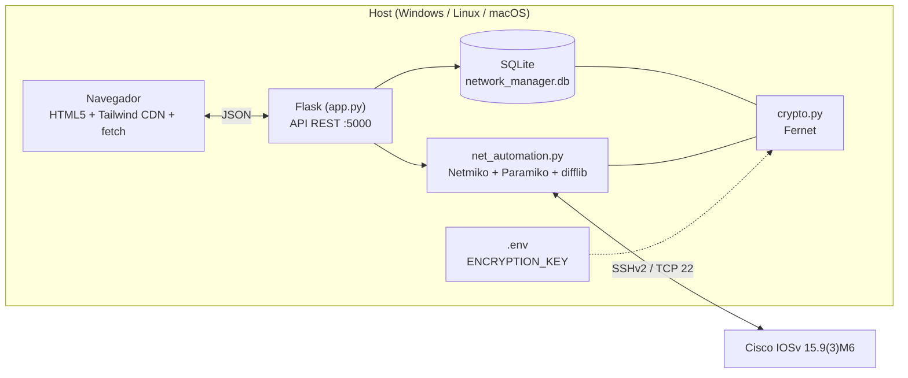

<div align="center">

# 🛰️ Network Config Manager

**Gestión automatizada de configuraciones para equipos Cisco IOS / IOSv: respaldos por SSHv2, auditoría con *diff* y *rollback* controlado, con credenciales cifradas en reposo.**


-2E7D32)

M6-049fd9?logo=cisco&logoColor=white)


</div>

---

## 1. Descripción ejecutiva

**Network Config Manager** es una aplicación web de NetDevOps para administrar el ciclo de vida de las configuraciones de routers y switches **Cisco IOS / IOSv**. Desde una única interfaz permite:

- **Inventariar** dispositivos, guardando su contraseña SSH y su *enable secret* **cifrados con Fernet** (nunca en texto plano).
- **Respaldar** el `running-config` en vivo por **SSHv2** (Netmiko/Paramiko) y conservar el historial versionado en SQLite.
- **Auditar cambios** comparando dos versiones con un *diff* unificado (`difflib`) calculado en el backend y resaltado en el navegador.
- **Restaurar (rollback)** una configuración anterior sobre el equipo real, con confirmación explícita y guardado en NVRAM (`write memory`).

El proyecto se diseñó bajo una gobernanza explícita ([`RULES.md`](RULES.md) y [`ARCHITECTURE.md`](ARCHITECTURE.md)): frontend *zero-build*, consultas SQL parametrizadas, secretos fuera del repositorio y manejo explícito de errores de red.

---

## 2. Arquitectura y características clave



### 🔐 Cifrado de credenciales en reposo
- `encrypted_password` y `encrypted_secret` se almacenan como tokens **Fernet** (AES-128-CBC + HMAC-SHA256) mediante [`crypto.py`](crypto.py).
- La clave maestra `ENCRYPTION_KEY` vive **solo** en `.env` (excluido por `.gitignore`); el repositorio incluye únicamente [`.env.example`](.env.example).
- Las contraseñas se descifran **en memoria** justo antes de abrir la sesión SSH y se descartan al terminar (`finally`).
- La API **nunca** devuelve contraseñas ni *secrets*, ni en claro ni cifrados.
- `enable secret` es **opcional** por dispositivo.

### ⚙️ Motor de automatización SSHv2 (`net_automation.py`)
- Conexión con `ConnectHandler` (`device_type="cisco_ios"` por defecto), `fast_cli=False`, y `clear_buffer()` antes de operar.
- **Timeouts calibrados para IOSv real (QEMU):** `timeout`, `conn_timeout`, `auth_timeout` y `banner_timeout` = 30 s, `read_timeout_override` = 30 s, `global_delay_factor` = 2.0; `show running-config` con `read_timeout=30` y `send_config_set` con `read_timeout=60`.
- **Privilegios:** `enable()` solo se invoca si `not conn.check_enable_mode()`; con usuarios `privilege 15` (prompt `#`) no se pide contraseña de enable.
- **Compatibilidad con Cisco IOSv 15.9(3)M6:** este IOS solo ofrece algoritmos SHA-1 (`diffie-hellman-group14-sha1`, host key `ssh-rsa`). Las versiones recientes de Paramiko los eliminaron (verificado con 5.1.0: *"no acceptable kex algorithm"*), por lo que el proyecto fija **Paramiko 3.5.1**, que los conserva. Además se pasa `disabled_algorithms={"pubkeys": ["rsa-sha2-256", "rsa-sha2-512"]}`.
- **Funciones públicas:** `test_connection()`, `fetch_running_config()` (limpia las cabeceras volátiles `Building configuration...` y `Current configuration : ... bytes`), `apply_configuration()` (envía líneas con `send_config_set()` y guarda con `save_config()`) y `calculate_diff()`.
- **Errores explícitos:** `NetmikoAuthenticationException`, `NetmikoTimeoutException` (conservando el detalle original) y errores de transporte (`socket.error`, `OSError`, `EOFError`, `NetmikoBaseException` y `SSHException` de Paramiko) → `ConnectionError`. Ningún mensaje incluye credenciales.

### 🔍 Comparador de versiones y rollback
- `difflib.unified_diff(..., lineterm="")` en el backend, con normalización de saltos de línea (`\r\n` → `\n`).
- El navegador resalta adiciones (`+`, verde), supresiones (`-`, rojo), bloques (`@@`, azul) y muestra contadores de cambios.
- El *rollback* (desde la tabla de historial, el visor o el comparador) exige confirmar en un `<dialog>` modal nativo y reporta el resultado con notificaciones (*toasts*) y la salida CLI del equipo.

### 🎨 Frontend *zero-build*
- HTML5 semántico (`header`, `main`, `section`, `article`, `nav`, `dialog`, `table`, `form`), **Tailwind CSS vía CDN** y JavaScript nativo con **Fetch API**.
- Sin Node.js, npm, bundlers ni frameworks. El DOM se construye con `textContent`/`createElement` (sin inyectar HTML de datos remotos).
- Funciones: alta de dispositivos, prueba SSH, respaldo inmediato, visor monoespaciado del `running-config`, **copiar** al portapapeles y **descargar `.cfg`**.

### 🗄️ Persistencia
- SQLite puro (`sqlite3`) con `PRAGMA foreign_keys = ON` y **consultas parametrizadas (`?`)**.
- Tablas `devices` y `backups` (`ON DELETE CASCADE`) con índices, y migración idempotente de columnas (`encrypted_secret`, `port`) para bases de datos existentes.

---

## 3. Stack tecnológico

| Capa | Tecnología | Versión validada |
| :--- | :--- | :--- |
| Lenguaje | Python | 3.12.10 |
| Servidor web / API | Flask (Werkzeug / Jinja2) | 3.1.3 (3.1.9 / 3.1.6) |
| Automatización de red | Netmiko | 4.8.0 |
| Transporte SSH | Paramiko | **3.5.1** (fijada por compatibilidad con IOSv) |
| Cifrado | `cryptography` (Fernet) | 50.0.2 |
| Variables de entorno | python-dotenv | 1.2.4 |
| Persistencia | SQLite (`sqlite3` de la biblioteca estándar) | — |
| Comparación | `difflib` (biblioteca estándar) | — |
| Frontend | HTML5 + Tailwind CSS (CDN) + JavaScript nativo | — |
| Pruebas | `unittest` + `unittest.mock` | — |

### Entorno de laboratorio validado
- **GNS3** (cliente en Windows) + **GNS3 VM** sobre **VMware Workstation**.
- **Cisco IOSv 15.9(3)M6** accesible en `192.168.76.10`, SSHv2 en el puerto 22, usuario con `privilege 15`.

<details>
<summary>Preparación de referencia del router (IOS)</summary>

```
hostname R1
ip domain-name lab.local
crypto key generate rsa modulus 2048
ip ssh version 2
username admin privilege 15 secret <contraseña>
enable secret <secret>
line vty 0 4
 login local
 transport input ssh
```
</details>

---

## 4. Estructura del repositorio

```text
network-config-manager/
├── app.py                    # Servidor Flask y API REST (puerto 5000)
├── database.py               # Capa de acceso a datos SQLite (DAL, consultas parametrizadas)
├── net_automation.py         # Netmiko/Paramiko: test, backup, apply_configuration, difflib
├── crypto.py                 # Cifrado/descifrado Fernet (lee ENCRYPTION_KEY de .env)
├── templates/
│   └── index.html            # Interfaz web (HTML5 + Tailwind CDN + JS nativo)
├── test_api.py               # Pruebas de integración de la API Flask (6)
├── test_db_crypto.py         # Pruebas de persistencia y cifrado (8)
├── test_net_automation.py    # Pruebas con mocks del motor de red y del diff (17)
├── test_db.py                # Script de verificación rápida de SQLite + Fernet
├── ARCHITECTURE.md           # Topología, modelo de datos, contratos y flujo
├── RULES.md                  # Reglas de gobernanza técnica
├── .env.example              # Plantilla de variables de entorno
├── .gitignore                # Excluye .env, *.db, venv/ y __pycache__/
├── .specify/                 # Especificaciones y plantillas Spec Kit
│   └── specs/
│       ├── 01-database-and-inventory.md
│       └── 02-network-automation.md
└── .agents/skills/           # Skills de Spec Kit para asistentes de IA
```

Archivos generados localmente y **no versionados**: `.env`, `network_manager.db` y `venv/`.

---

## 5. Instalación y ejecución local

> Requisitos: **Python 3.12** y **Git**.

### Windows (PowerShell)

```powershell
# 1. Clonar y entrar al proyecto
git clone https://github.com/Freazy17/network-config-manager.git
cd network-config-manager

# 2. Entorno virtual (si PowerShell bloquea el script: Set-ExecutionPolicy -Scope Process Bypass)
python -m venv venv
.\venv\Scripts\Activate.ps1

# 3. Dependencias
python -m pip install --upgrade pip
pip install "Flask==3.1.3" "netmiko==4.8.0" "paramiko==3.5.1" "cryptography==50.0.2" "python-dotenv==1.2.4"

# 4. Clave Fernet en .env (a partir de .env.example)
Copy-Item .env.example .env
$key = python -c "from cryptography.fernet import Fernet; print(Fernet.generate_key().decode())"
(Get-Content .env) -replace 'genera_tu_propia_llave_fernet_aqui', $key | Set-Content .env -Encoding ascii

# 5. Pruebas
python -m unittest discover -s . -p "test_*.py" -v

# 6. Servidor
python app.py
```

### Linux / macOS (bash/zsh)

```bash
# 1. Clonar y entrar al proyecto
git clone https://github.com/Freazy17/network-config-manager.git
cd network-config-manager

# 2. Entorno virtual
python3.12 -m venv venv
source venv/bin/activate

# 3. Dependencias
python -m pip install --upgrade pip
pip install "Flask==3.1.3" "netmiko==4.8.0" "paramiko==3.5.1" "cryptography==50.0.2" "python-dotenv==1.2.4"

# 4. Clave Fernet en .env (a partir de .env.example)
cp .env.example .env
KEY=$(python -c "from cryptography.fernet import Fernet; print(Fernet.generate_key().decode())")
python - "$KEY" <<'PY'
import sys, pathlib
p = pathlib.Path(".env")
p.write_text(p.read_text().replace("genera_tu_propia_llave_fernet_aqui", sys.argv[1]))
PY

# 5. Pruebas
python -m unittest discover -s . -p "test_*.py" -v

# 6. Servidor
python app.py
```

Abre **http://127.0.0.1:5000**, registra tu router (por ejemplo `192.168.76.10`, puerto `22`) y usa **Probar SSH** → **Respaldar** → **Comparar** → **Rollback**.

> ⚠️ **Conserva tu `ENCRYPTION_KEY`.** Si la cambias o la pierdes, las contraseñas ya almacenadas no podrán descifrarse (`InvalidToken`) y habrá que volver a registrar los dispositivos.

---

## 6. API REST

Todas las respuestas son JSON con la forma `{"status": "success" | "error", "message": ..., "data": ...}`. Los errores de red del equipo se traducen así: autenticación → `401`, timeout → `504`, transporte/otros → `502`.

| Método | Ruta | Descripción | Parámetros / payload | Códigos |
| :--- | :--- | :--- | :--- | :--- |
| `GET` | `/` | Sirve la interfaz web (`templates/index.html`). | — | `200` |
| `GET` | `/api/devices` | Lista el inventario con el resumen de sus respaldos (`id`, `timestamp`, `size_bytes`). Sin credenciales. | — | `200` |
| `POST` | `/api/devices` | Registra un dispositivo; cifra `password` y `secret` con Fernet. | JSON: `hostname` (o `name`), `ip_address`, `username`, `password` (obligatorios); `device_type` (def. `cisco_ios`), `port` (def. `22`, 1–65535), `secret` (opcional) | `201` creado · `400` JSON/campos/IP/puerto inválidos · `409` IP duplicada |
| `DELETE` | `/api/devices/<id>` | Elimina el dispositivo y sus respaldos (cascada). | Ruta: `id` (entero) | `200` · `404` |
| `POST` | `/api/devices/<id>/test` | Prueba SSH (y `enable` si hay *secret*) con `test_connection()`. | Ruta: `id` | `200` `connected: true` · `404` · `502` `connected: false` |
| `POST` | `/api/devices/<id>/backup` | Extrae el `running-config` en vivo y lo guarda como nueva versión. | Ruta: `id` | `201` (`id`, `timestamp`, `size_bytes`, `config_text`) · `404` · `401` · `504` · `502` |
| `GET` | `/api/devices/<id>/backups` | Historial de respaldos del dispositivo (más reciente primero). | Ruta: `id` | `200` · `404` |
| `GET` | `/api/backups/<id>` | Contenido completo de un respaldo (`config_text`). | Ruta: `id` del respaldo | `200` · `404` |
| `GET` | `/api/devices/<id>/diff` | *Diff* unificado entre dos respaldos del dispositivo (`has_changes`, `diff_lines`, `unified_diff`). | Query: `v1`, `v2` (IDs de respaldo, obligatorios y enteros) | `200` · `400` · `404` |
| `POST` | `/api/devices/<id>/rollback/<backup_id>` | Aplica el respaldo al equipo con `apply_configuration()` y guarda en NVRAM. | Ruta: `id`, `backup_id` | `200` (`commands_applied`, `output`) · `404` · `401` · `504` · `502` |

**Ejemplo — registrar un dispositivo**

```bash
curl -X POST http://127.0.0.1:5000/api/devices \
  -H "Content-Type: application/json" \
  -d '{"hostname":"R1","ip_address":"192.168.76.10","port":22,"device_type":"cisco_ios","username":"admin","password":"<contraseña>","secret":"<secret>"}'
```

---

## 7. Pruebas y validación en laboratorio

### Suite automatizada — 31 pruebas `unittest`

```bash
python -m unittest discover -s . -p "test_*.py" -v
```

| Archivo | Pruebas | Cobertura |
| :--- | :---: | :--- |
| [`test_db_crypto.py`](test_db_crypto.py) | 8 | Contraseña **no** presente en texto plano en la BD ni en los bytes del archivo `.db`; ida y vuelta Fernet; ocultamiento de credenciales en consultas; rechazo de tokens manipulados (HMAC); neutralización de inyección SQL; borrado en cascada; cifrado de `encrypted_secret`; *secret* opcional y migración de tablas heredadas. |
| [`test_net_automation.py`](test_net_automation.py) | 17 | Con *mocks* de Netmiko: `test_connection`, `fetch_running_config` (limpieza de cabeceras, parámetros de conexión, `enable()` condicional con `privilege 15`), `apply_configuration` (filtrado de comandos, `send_config_set` + `save_config`), errores de autenticación/timeout/socket/`SSHException`, sin fuga de credenciales y `calculate_diff` (marcadores `+`/`-`, configuraciones idénticas). |
| [`test_api.py`](test_api.py) | 6 | Cliente de pruebas de Flask con BD temporal: las 10 rutas, códigos de error y ausencia de credenciales en las respuestas. |
| [`test_db.py`](test_db.py) | script | Verificación rápida (`python test_db.py`) con la BD real: inserta un router con *password* y *secret*, confirma el cifrado, descifra y borra el registro. |

> `test_db.py` opera sobre `network_manager.db` (crea la base si no existe y elimina el registro de prueba al terminar).

### Escenario real contra Cisco IOSv

Flujo funcional contra el laboratorio **GNS3 + GNS3 VM (VMware Workstation) con Cisco IOSv 15.9(3)M6 en `192.168.76.10`** (SSHv2, puerto 22, usuario `privilege 15` y *enable secret*):

1. Registrar el router desde la interfaz (credenciales cifradas con Fernet en SQLite).
2. **Probar SSH** (`POST /api/devices/<id>/test`).
3. **Respaldar** el `running-config` (`POST /api/devices/<id>/backup`) y consultarlo en el visor.
4. Modificar la configuración del router, generar un segundo respaldo y **comparar** ambas versiones (`GET /api/devices/<id>/diff`).
5. **Rollback** a la versión anterior con confirmación (`POST /api/devices/<id>/rollback/<backup_id>`).

La compatibilidad SSH se verificó con una negociación real contra el equipo: Paramiko 3.5.1 acuerda host key `ssh-rsa`, cifrado `aes128-ctr` y MAC `hmac-sha2-256`, mientras que Paramiko 5.1.0 falla con `no acceptable kex algorithm`.

---

## 8. Consideraciones y limitaciones conocidas

- **Alcance de laboratorio.** La API **no tiene autenticación** y `app.py` escucha en `0.0.0.0:5000` (servidor de desarrollo de Flask, `debug=False`). Úsalo en una red de laboratorio de confianza, o cambia el `host` a `127.0.0.1` o restríngelo con un firewall antes de exponerlo.
- **El rollback es aditivo.** `apply_configuration()` envía las líneas del respaldo (sin comentarios `!`, cabeceras ni `end`) con `send_config_set()`; **no elimina** las líneas añadidas después del respaldo. Revisa el *diff* antes de restaurar.
- **Los respaldos se guardan tal cual.** `raw_config` no se cifra; un `running-config` puede contener *hashes* de contraseñas, comunidades SNMP u otros datos sensibles. Protege el archivo `network_manager.db` (ya excluido de Git).
- **Sin verificación de *host key* SSH.** Netmiko usa por defecto una política permisiva (`ssh_strict=False`).
- **Dependencia fijada.** Paramiko debe permanecer en **3.5.1** mientras se gestionen equipos IOS/IOSv que solo ofrecen algoritmos SHA-1.
- **Gobernanza.** Las reglas del proyecto están en [`RULES.md`](RULES.md); la topología, el modelo de datos y el flujo, en [`ARCHITECTURE.md`](ARCHITECTURE.md).
